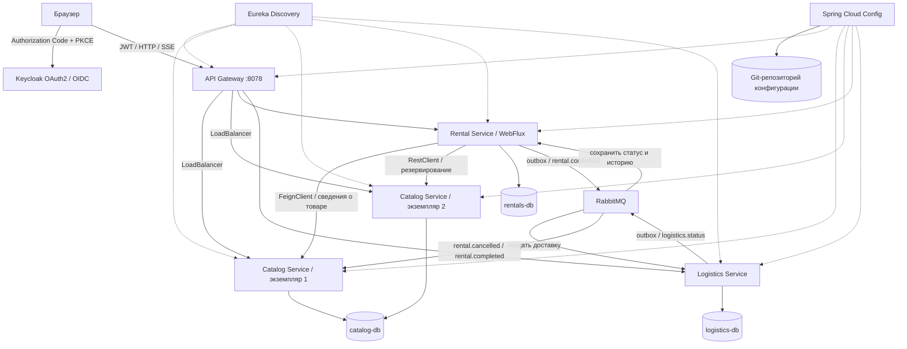

# TourRent

Система аренды и доставки туристического снаряжения. Практическая работа №8 по дисциплине «Проектирование и разработка клиент-серверных приложений».

**Автор: Прокофьев И.Р., ИКБО-11-23.**

Пользователь выбирает снаряжение на нужные даты, оформляет аренду, наблюдает за доставкой, а после поездки вызывает курьера для возврата. Каталог предотвращает превышение количества доступных единиц при параллельном бронировании. Даты заданы как полуинтервал `[начало, возврат)`.

## Быстрый запуск

Необходим Docker Desktop с Linux-контейнерами. Java и Maven на компьютере не требуются: сборка и Unit-тесты выполняются внутри Docker.

```powershell
cd "Практическая работа №8/TourRent"
docker compose up --build -d --wait
```

При первом запуске загружаются образы и Maven-зависимости. Следующие запуски используют кэш. После сборки достаточно `docker compose up -d --wait`.

- Приложение: [http://localhost:8078](http://localhost:8078).
- Учебный пользователь: **demo**, пароль **Demo12345!**.
- Keycloak: [http://localhost:8180](http://localhost:8180), администратор **admin / admin-demo**.
- Eureka: [http://localhost:8768](http://localhost:8768).
- RabbitMQ Management: [http://localhost:15678](http://localhost:15678), **tourrent / tourrent-demo**.
- Git-конфигурация: [http://localhost:8888/rental-service/default/main](http://localhost:8888/rental-service/default/main).

Все эти адреса привязаны к loopback компьютера. Бизнес-сервисы и PostgreSQL не публикуют порты на хосте. Учебные пароли предназначены для локального стенда.

Остановка: `docker compose stop`. Удаление контейнеров с сохранением данных: `docker compose down`. Томами управляет Docker; обычный запуск не удаляет бронирования и события.

## Архитектура



Сервисы независимо запускаются, имеют собственные схемы и экземпляры PostgreSQL. Два контейнера каталога — реплики одного сервиса и используют одну БД каталога. Прямых запросов к чужой БД в бизнес-коде нет.

| Компонент | Ответственность |
|---|---|
| Catalog Service | Снаряжение, тарифы, количество и резервирование на даты |
| Rental Service | Аренды пользователя, расчёт стоимости, отмена, возврат и история SSE |
| Logistics Service | Исходящая доставка, забор при возврате и состояния перевозки |
| API Gateway | Единственная точка входа в бизнес-API, проверка JWT, идентификация пользователя, маршрутизация |
| Eureka | Регистрация экземпляров и обнаружение сервисов |
| Config Server | Чтение настроек из настоящего Git-репозитория ветки main |
| RabbitMQ | Долговечные очереди интеграционных событий, повторная доставка и очередь ошибок |
| Keycloak | OAuth2 / OpenID Connect, пользователи и подпись JWT |

Технологии: Java 21, Spring Boot 3.5.6, Spring Cloud 2025.0.0, OpenFeign, Spring Cloud LoadBalancer, WebFlux/Reactor, JDBC, Resilience4j 2.2.0, RabbitMQ 4.1, PostgreSQL 17, Keycloak 26.0.7.

## Соответствие требованиям

| Требование | Реализация |
|---|---|
| Минимум три бизнес-сервиса | Catalog, Rental, Logistics |
| Отдельная БД каждого сервиса | Три контейнера PostgreSQL и три тома |
| API Gateway | Spring Cloud Gateway; маршруты `lb://...` |
| OAuth2 | Браузерный Authorization Code + PKCE S256, проверка подписи, срока действия и issuer JWT |
| Config Server + Git | Git-репозиторий создаётся внутри образа из `config-repository`, имеется commit SHA |
| Service Discovery | Eureka, регистрация экземпляров по hostname |
| Балансировка | Gateway и синхронные клиенты используют Spring Cloud LoadBalancer; две реплики каталога |
| FeignClient | `CatalogClient.equipment` при создании аренды |
| RestClient / WebClient | RestClient резервирует товар; WebClient собирает health компонентов |
| Асинхронный сценарий | RabbitMQ: подтверждение аренды → доставка → статусы → аренда |
| Идемпотентность | `processed_events(event_id PK)` в транзакции; `deliveries.rental_id UNIQUE` |
| Timeout / retry / Circuit Breaker | 1,2 с подключение, 2 с чтение; GET до двух попыток; Circuit Breaker 8 с |
| WebFlux / Mono / Flux | Реактивный Rental API и возобновляемый SSE-поток |
| Request ID | Gateway → HTTP-клиенты → outbox → RabbitMQ → журналы потребителей |
| Health | Actuator каждого сервиса и `/api/system` |
| Docker Compose | Все компоненты запускаются одним Compose-проектом |
| Unit-тесты | `mvn verify` автоматически при сборке образов |
| Kubernetes / локальный Minikube | `k8s/tourrent.json`, `deploy-minikube.ps1` |

## Бизнес-сценарий

1. Пользователь входит через Keycloak и открывает каталог.
2. Выбирает даты, количество, получателя и адрес. Цена = суточный тариф × число дней × количество.
3. Gateway проверяет JWT и заменяет присланный `X-User-ID` настоящим subject токена.
4. Rental Service запрашивает товар через FeignClient, затем резервирует его через RestClient.
5. Catalog Service блокирует строку товара `SELECT FOR UPDATE`, проверяет максимум одновременных бронирований по дням и сохраняет резерв.
6. Rental Service в одной локальной транзакции сохраняет аренду, историю и outbox-событие `rental.confirmed`.
7. Relay отправляет событие в RabbitMQ и помечает его отправленным только после publisher confirm.
8. Logistics Service транзакционно запоминает eventId, создаёт одну доставку и публикует её состояние через собственный outbox.
9. Rental Service сохраняет новую историю. Браузер получает изменения по SSE.
10. После получения снаряжения пользователь оформляет возврат. Курьерская симуляция доводит аренду до COMPLETED, а событие освобождает резерв каталога.

```text
CONFIRMED → DELIVERY_CREATED → IN_TRANSIT → DELIVERED
                                               ↓ пользователь оформляет возврат
COMPLETED ← RETURN_IN_TRANSIT ← RETURN_REQUESTED
```

Отмена разрешена в CONFIRMED и DELIVERY_CREATED. Переходы проверяются в `RentalRules`; запоздавшее событие не возвращает завершённую или отменённую аренду к предыдущему статусу.

## События и надёжность

Обменник: `tourrent.events`, тип topic. Долговечные очереди: `logistics.rentals`, `rentals.logistics`, `catalog.releases`. Необработанные после четырёх попыток сообщения направляются через dead-letter exchange в `tourrent.failures`.

Контракт содержит `eventId`, `type`, `rentalId`, `requestId`, `data`, `occurredAt`. Событие создания передаёт только идентификатор владельца, получателя и адрес, необходимые логистике. Полные модели БД и JWT в брокер не отправляются.

Доставка событий — **at least once**. Уникальный eventId и бизнес-ключ аренды защищают от дублей. Таблица processed_events изменяется в той же транзакции, что и бизнес-состояние. При откате событие можно обработать повторно. Нельзя называть такую реализацию протокольной exactly once.

Relay рассчитан на один активный экземпляр Rental Service и Logistics Service. В стенде масштабируется только Catalog Service. Для нескольких relay одного сервиса потребуются аренда строк или `FOR UPDATE SKIP LOCKED` на outbox.

Резервирование и создание аренды находятся в разных сервисах. Если локальная транзакция создания завершается ошибкой, выполняется компенсирующее освобождение резерва. При одновременном отказе БД аренды и каталога компенсация требует ручной сверки по rentalId из журнала; полноценная долговечная Saga не заявляется.

## Реактивная обработка

Rental Service использует Netty и WebFlux. JDBC, Feign и RestClient являются блокирующими; они выполняются через `Mono.fromCallable(...).subscribeOn(Schedulers.boundedElastic())`, а не на event loop. Система не заявляется полностью неблокирующей до уровня PostgreSQL.

SSE основан на долговечной таблице `rental_history`, опрашиваемой раз в секунду. Поле `id` соответствует sequence; `Last-Event-ID` позволяет получить только последующие записи. Поток заканчивается после COMPLETED или CANCELLED. Браузер читает его через fetch ReadableStream с заголовком Authorization.

## Проверка отказа

```powershell
docker compose stop catalog-service catalog-service-2
# Попробовать оформить новую аренду в интерфейсе.
# Ожидается 503 с сообщением и ограниченным временем ожидания.
docker compose start catalog-service catalog-service-2
```

Повторяется только чтение товара; семантические 404 и 409 не повторяются. Circuit Breaker открывается после двух неуспешных вызовов, выдерживает паузу 8 секунд и допускает пробный вызов. У Eureka и LoadBalancer есть небольшое окно обновления сведений об экземплярах. Уже созданные доставки не требуют доступности каталога.

## Тесты и доказательства

```powershell
# Java Unit-тесты запускаются каждой сборкой.
docker compose build

# Полная интеграционная проверка, Node.js 20+ на хосте.
node tools/verify.cjs

# Ручная демонстрация из PowerShell.
.\demo.ps1
```

`tools/verify.cjs` проверяет OAuth/JWT, балансировку, валидацию, расчёт стоимости, SSE и Last-Event-ID, повторную публикацию RabbitMQ-события, возврат, снятие резерва, конкурентное бронирование, отмену, Git-конфигурацию, корреляцию и отказ/восстановление каталога. Тест использует исключительно Compose-проект `tourrent`, временно останавливает его каталог и оставляет демонстрационные аренды в истории.

Фактические результаты и скриншоты находятся в `evidence/`. Токены доступа в протоколы не сохраняются. Запросы для IDE приведены в `requests.http`; даты в ручном примере следует заменить будущими.

## Minikube

Отдельный профиль не затрагивает существующие кластеры:

```powershell
.\deploy-minikube.ps1
kubectl --context=tourrent-pr8 -n tourrent get pods,svc,pvc
```

Если Compose уже использует порты 8078 и 8180, остановить его: `docker compose stop`. Затем в двух терминалах:

```powershell
kubectl --context=tourrent-pr8 -n tourrent port-forward svc/api-gateway 8078:8080
kubectl --context=tourrent-pr8 -n tourrent port-forward svc/keycloak 8180:8080
```

Открыть тот же адрес приложения и войти той же учебной учётной записью. У Minikube отдельные PVC, поэтому его данные независимы от Compose. При повторной загрузке изменённых образов выполнить `kubectl --context=tourrent-pr8 -n tourrent rollout restart deployment`.

Стенд использует HTTP на localhost, встроенную H2 Keycloak в собственном томе и простой учебный набор секретов. Для облака потребуются публичный HTTPS issuer, постоянный PostgreSQL для Keycloak и Secret вместо открытых учебных значений.

## Публикация и сдача

Репозиторий курса: [Relax1205/PiRKSP_2](https://github.com/Relax1205/PiRKSP_2). Новый проект находится в `Практическая работа №8/TourRent`; перед сдачей изменения необходимо закоммитить и отправить в репозиторий. Локальная подготовка не является публикацией на GitHub.

К отчёту необходимо отдельно приложить личный скриншот завершения BootcampLabs. Его прохождение не подтверждается приложением и не подменяется техническими скриншотами стенда. Собственная тема подлежит согласованию с семинаристом согласно заданию.

## Документация технологий

- [Spring Cloud — совместимость версий](https://spring.io/projects/spring-cloud/)
- [Spring Cloud OpenFeign](https://docs.spring.io/spring-cloud-openfeign/reference/spring-cloud-openfeign.html)
- [Spring Cloud Config — Git backend](https://docs.spring.io/spring-cloud-config/reference/server/environment-repository/git-backend.html)
- [Spring Cloud Gateway](https://docs.spring.io/spring-cloud-gateway/reference/4.3/spring-cloud-gateway-server-webflux/configuration.html)
- [Keycloak OpenID Connect](https://www.keycloak.org/securing-apps/oidc-layers)
- [Spring AMQP](https://docs.spring.io/spring-amqp/reference/amqp/template.html)
